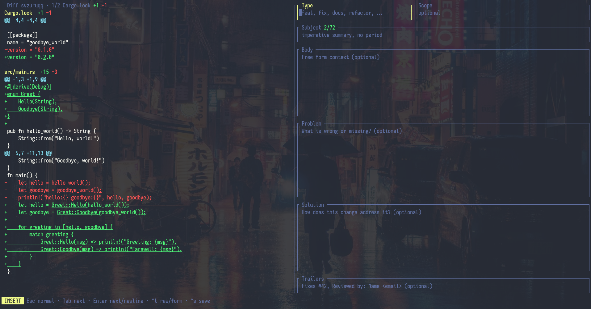
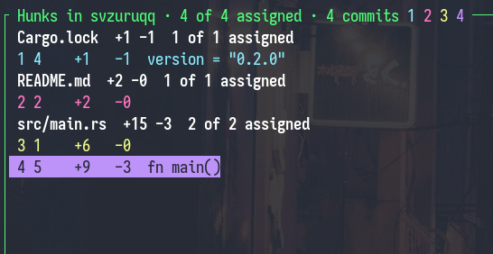

# jj-compose

<p align="center">
  <a href="https://crates.io/crates/jj-compose"></a>
  <a href="https://docs.rs/jj_compose_core"></a>
  <a href="LICENSE"></a>
</p>

A terminal UI for Jujutsu ([jj](https://jj-vcs.github.io/jj/)) that splits
working-copy changes into atomic
[Conventional Commits](https://www.conventionalcommits.org/) while you view the
diff.

<p align="center">
  
</p>

## Features

- **Conventional Commits form:** validates type, scope, header length (50/72),
  and trailers.
- **Hunk and line splitting:** `Alt-s` walks the change hunk by hunk so you can
  assign hunks to numbered commits. `e` divides a hunk so its lines can go to
  different commits. No `ui.diff-editor` setup needed.
- **Live diff:** shown beside the form, stacks on narrow terminals, and flags
  itself stale when files change.
- **Lossless revising:** existing messages the form can't reproduce exactly open
  in a raw editor, untouched.
- **Vim keymap:** `--keymap vim` for modal editing.
- **External tools:** `o` opens the diff in Meld, Difftastic, etc.
- **Rewriting released history:** `--ignore-immutable` can split a tagged
  release and prints the commands to re-anchor stranded tags.

## Install

```sh
cargo install jj-compose
# or a prebuilt binary:
cargo binstall jj-compose
```

Add an alias so it runs as `jj compose`:

```toml
# ~/.config/jj/config.toml
[aliases]
compose = ["util", "exec", "--", "jj-compose"]
# always use Vim keys:
# compose = ["util", "exec", "--", "jj-compose", "--keymap", "vim"]
```

## Quick start

`@` holds a bug fix, a refactor, and a docs tweak. Run `jj compose`, then:

1. Press `Alt-s` to enter split mode, then `f` to list every hunk.
2. Move with `j`/`k`. Press `1` on the fix hunks and `2` on the refactor hunks.
   Leave the docs hunks unassigned. `0` (or the same digit again) unassigns.
3. Press `Enter`, write the message for commit 1, and press `Ctrl-s`. Repeat for
   commit 2.
4. Describe what's left (the docs tweak) last. That message goes on `@`.

```text
@  docs: clarify empty-input behavior
○  refactor(lexer): extract token helpers
○  fix(parser): return no tokens for empty input
```

Lower numbers commit first, so order them so each commit builds. `Alt-←` goes
back to the hunks. For a single commit, skip `Alt-s` and just fill in the form.

## Usage

```sh
jj-compose              # describe @
jj-compose -r @-        # revise the parent's description
jj-compose <revset>     # any single mutable revision
```

| Option                    | Effect                                                       |
| ------------------------- | ------------------------------------------------------------ |
| `-r, --revision <REVSET>` | Revision to describe (or pass it positionally). Default `@`. |
| `-R, --repository <PATH>` | Repository to operate on, as with `jj -R`.                   |
| `--keymap <default\|vim>` | Key bindings. Also set by `JJ_COMPOSE_KEYMAP`.               |
| `--raw`                   | Start in the raw text editor instead of the form.            |
| `--diff-tool <NAME>`      | Tool `o`/`O` open the diff in. Also `JJ_COMPOSE_DIFF_TOOL`.  |
| `--ignore-immutable`      | Allow rewriting protected history. See below.                |

The revset must resolve to one mutable revision and is resolved once at launch.
Saving runs `jj describe` by change ID, so editing files while jj-compose is
open is safe. Saving an unchanged message does nothing.

## The message

```text
type(scope)!: subject

Free-form body text.

Problem:
What is wrong or missing.

Solution:
How this change addresses it.

Fixes #42
Reviewed-by: Name <email>
```

Only the header is required. A `!` at the end of the Type field marks a breaking
change. Trailers (a final paragraph of `Token: value` or `Token #value` lines,
including `BREAKING CHANGE:`) are checked on save. The Subject title shows the
header length: green up to 50, yellow up to 72, red beyond.

An existing description opens in the form only if the form can reproduce it byte
for byte. Otherwise it opens in the raw editor and the status bar says why.
`Ctrl-t` toggles between form and raw. Raw text is saved exactly as typed,
without validation.

## The diff pane

The diff uses git format with jj's colors (`ui.diff-formatter` is ignored).
Below 100 columns it sits above the form instead of beside it. When describing
`@`, editing a file in the diff marks the pane `stale: r to reload`.

## Keys

### Everywhere

| Key                 | Action                                |
| ------------------- | ------------------------------------- |
| `Ctrl-s`            | Save and run `jj describe`            |
| `Ctrl-c`            | Quit (asks again if there are edits)  |
| `Ctrl-t`            | Switch between form and raw text      |
| `Alt-s`             | Start splitting the change            |
| `Tab` / `Shift-Tab` | Next / previous field, then the diff  |
| `Alt-←` / `Alt-→`   | Jump to the diff / back to the editor |
| `PgDn` / `PgUp`     | Scroll the diff half a page           |
| `Alt-↓` / `Alt-↑`   | Scroll the diff one line              |

Type and Scope sit side by side above Subject. Moving past the edge of a field's
text goes to the field next to it on screen. In the Vim keymap that includes the
diff (left of the form, or above it on narrow terminals); default-keymap arrows
never leave the form. Tab and `Enter` follow top-to-bottom order.

### Default keymap

| Key                                    | Action                                  |
| -------------------------------------- | --------------------------------------- |
| `Enter`                                | Next field (one-line fields) or newline |
| Arrows at a field's edge               | The adjacent field                      |
| `Esc`                                  | Quit (asks again if there are edits)    |
| `Shift`+arrows                         | Select                                  |
| `Ctrl-x` / `Alt-w` / `Ctrl-y`          | Cut / copy / paste (internal clipboard) |
| `Ctrl-z` or `Ctrl-u` / `Ctrl-r`        | Undo / redo                             |
| `Ctrl-←` / `Ctrl-→`, `Alt-b` / `Alt-f` | Word left / right                       |
| `Ctrl-w`, `Alt-Backspace` / `Alt-d`    | Delete word before / after              |
| `Home` / `End`, `Ctrl-a` / `Ctrl-e`    | Line start / end                        |
| `Ctrl-k` / `Ctrl-j`                    | Delete to end / start of line           |

### Vim keymap

Starts in Insert mode for a new description, Normal mode when revising one.
Insert mode uses the default editing keys.

| Key                                                 | Action                               |
| --------------------------------------------------- | ------------------------------------ |
| `h` `j` `k` `l`, `w` `b` `e`, `0` `^` `$`, `gg` `G` | Motions                              |
| `h` `j` `k` `l` past the edge of a field's text     | The box in that direction            |
| `Enter`                                             | Next field                           |
| `i` `a` `I` `A` `o` `O`                             | Insert                               |
| `x` `D` `C` `S` `J`                                 | Edit                                 |
| `d` `c` `y` + motion, `dd` `cc` `yy`, `p` `P`       | Operators and paste                  |
| `v` / `V`                                           | Visual / visual line                 |
| `u` / `Ctrl-r`                                      | Undo / redo                          |
| `Ctrl-d` / `Ctrl-u`, `Ctrl-e` / `Ctrl-y`            | Scroll the diff                      |
| `q`                                                 | Quit (asks again if there are edits) |

### Diff pane

| Key                          | Action                                                       |
| ---------------------------- | ------------------------------------------------------------ |
| `j` / `k`, `↓` / `↑`         | Scroll a line                                                |
| `Ctrl-d` / `Ctrl-u`, `Space` | Half page                                                    |
| `g` / `G`, `Home` / `End`    | Top / bottom                                                 |
| `]` / `[`                    | Next / previous file                                         |
| `}` / `{`                    | Next / previous hunk                                         |
| `f`                          | Show / hide the file list                                    |
| `/`, then `n` / `N`          | Search (smart case), next / previous match                   |
| `z`                          | Zoom the diff to the whole window                            |
| `r`                          | Reload the diff                                              |
| `H` / `L`, `←` / `→`         | Pan sideways                                                 |
| `l`, `Esc`, `Enter`, `i`     | Back to the editor                                           |
| `s`                          | Start splitting the change                                   |
| `o` / `O`                    | Open the current file / the whole change in an external tool |
| `q` (Vim keymap)             | Quit (asks again if there are edits)                         |

## Splitting a change

`Alt-s` (or `s` in the diff pane) shows one hunk at a time. Put hunks into
numbered commits; nothing is final until you commit. Lower numbers commit first.

| Key                             | Action                                                     |
| ------------------------------- | ---------------------------------------------------------- |
| `1` to `9`                      | Put this hunk in that commit                               |
| the same digit again, or `0`    | Take it back out                                           |
| `n` / `p`, `}` / `{`, `→` / `←` | Next / previous hunk                                       |
| `g` / `G`                       | First / last hunk                                          |
| `a` / `d`                       | Put the rest of this file in the same commit / take it out |
| `e`                             | Divide this hunk line by line                              |
| `f`                             | Show the whole change as a list                            |
| `V` / `v`                       | Open the list with a selection started                     |
| `Enter`                         | Done planning; go write the messages                       |
| `Esc`, `q`                      | Leave split mode, discarding the plan                      |
| `j` / `k`, `Ctrl-d` / `Ctrl-u`  | Scroll inside a hunk taller than the pane                  |

The title shows the whole plan: a colored digit per assigned hunk, `·` for
unassigned, and brackets round the current one.

<p align="center">
  
</p>

`f` lists every hunk with its commit, line number, size, and enclosing
definition. Each file heading shows how many of its hunks are assigned, so
leftovers are easy to spot. The list and the single-hunk view share one cursor.

<p align="center">
  
</p>

### Selecting a run of hunks

| Key                            | Action                                               |
| ------------------------------ | ---------------------------------------------------- |
| `V` / `v`                      | Start or cancel a selection                          |
| `j` / `k`, `Ctrl-d` / `Ctrl-u` | Stretch it a hunk / half a page                      |
| `]` / `[`                      | Stretch it to the next file / back to a file's start |
| `g` / `G`                      | Stretch it to the first / last hunk                  |
| `o`                            | Jump to the other end of the selection               |
| `1` to `9`                     | Put the whole selection in that commit (toggles)     |
| `0`, `d`, `x`                  | Take the whole selection back out                    |
| `Esc`                          | Cancel the selection; a second `Esc` closes the list |

`V G 1` puts everything from the cursor down in commit 1. Selections can span
files. Counts like `20j` aren't supported, since digits name commits.

### Dividing a hunk

When two unrelated edits share a hunk, `e` lets each `+`/`-` line go to its own
commit. `e` again closes it.

| Key                          | Action                                  |
| ---------------------------- | --------------------------------------- |
| `1` to `9`                   | Put this line in that commit            |
| the same digit again, or `0` | Take it back out                        |
| `j` / `k`, `n` / `p`         | Next / previous line                    |
| `g` / `G`                    | First / last line                       |
| `v` / `V`, then `o`          | Select a run of lines / jump to its end |
| `e`                          | Close it; lines that agree fold back up |
| `Ctrl-d` / `Ctrl-u`          | Move the cursor half a page             |

```text
┌ Divide wvkqrwwn · hunk 2/4 · src/app.rs · 11·· · 2/4 taken ─┐
│ fn run() {                                                  │
│-    let cnt = 0;                                            │
│+    let count = 0;                                          │
│-    if cnt > 1 {                                            │
│+    if count >= 1 {                                         │
│ }                                                           │
└─────────────────────────────────────────────────────────────┘
```

- Each removal is shown next to the addition replacing it. Lines no commit takes
  are struck through.
- Lines start in the hunk's commit, so to carve out one line: `1`, `e`, then `0`
  on that line.
- A `-` and its `+` are separate choices; taking only one leaves both in the
  file.
- `v j 1` sends a renamed pair to commit 1. A digit on a half-assigned selection
  assigns all of it.
- Once all remaining lines agree on one commit, the hunk goes there whole.

### Writing the messages

`Enter` moves to the form. Each `Ctrl-s` commits the current box and moves to
the next; the status bar shows `Describing commit 2 of 3: 2 hunks`. The form
starts with the original description, which carries over to the remainder as
with `jj split`, so delete the parts that don't belong.

- Unassigned hunks stay in the final change, described last.
- Putting every hunk in one box is just a describe.
- Binary files have no hunks and always stay with the remainder.

## Rewriting released history

<!--prettier-ignore-->
> [!WARNING]
> **Don't rewrite commits others rely on.** Only use this if nobody has pulled
> them, and be ready to force-push the rewritten tags.

`--ignore-immutable` passes jj's flag through, so protected revisions (tagged
releases, trunk) can be split. jj-compose can't undo either consequence:

- Tags on that revision or its descendants are stranded. jj-compose suggests
  moving them to the remainder, which holds all the original content.
- Every descendant gets a new hash.

The pane title shows `· immutable`, the status bar names the tags at risk, and
on exit jj-compose prints the fix:

```text
Rewriting immutable history left these tags behind:

  jj tag set v0.1.0 --allow-move -r oxuonltl    # was 0688276c (feat: three things at once)
  git push origin v0.1.0 --force
```

`jj git push` can't force-push a tag, hence `git push`. If the release is
already on crates.io, your history will disagree with the tarball. For a release
nobody has pulled yet, `jj op restore` is usually cleaner since it rolls back
the tag too.

## External diff tools

`o` opens the current file and `O` the whole change, via `jj diff --tool`. The
tool comes from `--diff-tool` / `JJ_COMPOSE_DIFF_TOOL`, otherwise
`ui.diff-editor`. `jj diff --tool` reads `diff-args`, not `edit-args`, so add
it:

```toml
# ~/.config/jj/config.toml
[ui]
diff-editor = "meld"

[merge-tools.meld]
program = "meld"
edit-args = ["--newtab", "$left", "$right"]
diff-args = ["--newtab", "$left", "$right"]   # for `o`/`O`
```

Terminal tools like `difft` are paged by jj; press `q` to return. If
`ui.diff-editor` is a split-only script (e.g. wrapping `git add -p`), point
`--diff-tool` at a real viewer.

## License

[Apache-2.0](https://github.com/saylesss88/jj-compose/blob/main/LICENSE)
